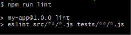
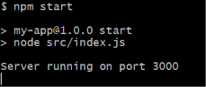
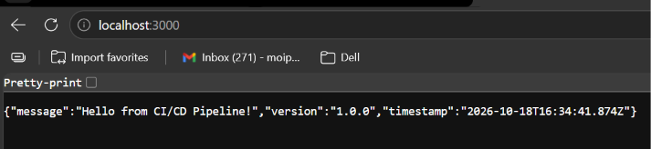
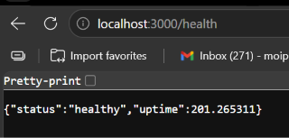
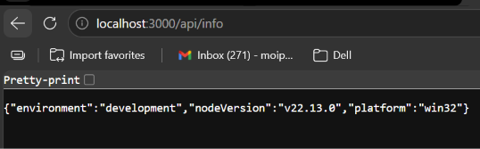

# AWS CI/CD Pipeline

A hands-on DevOps project demonstrating a basic continuous integration and continuous delivery (CI/CD) workflow for a Node.js application using **GitHub Actions** and **Amazon S3**.

The project covers application setup, local testing, GitHub repository configuration, automated workflow execution, and uploading build artifacts to an S3 bucket.

## Project overview

The sample application is a small Express service that runs on port `3000`. It exposes a root endpoint and two API endpoints for checking application health and retrieving runtime information.

The GitHub Actions workflow automates the pipeline checks and publishes the configured artifact to Amazon S3.

### Key features

- Node.js application built with Express.
- Health-check endpoint and application information endpoint.
- Automated linting with ESLint.
- Automated tests with Jest and coverage reporting.
- GitHub Actions workflow for CI/CD.
- AWS authentication and S3 artifact upload.
- Workflow monitoring and artifact verification using the AWS Console and AWS CLI.

## Technology stack

| Technology | Purpose |
| --- | --- |
| Node.js | JavaScript runtime |
| Express.js | Application server |
| ESLint | Code linting |
| Jest | Automated testing and coverage |
| GitHub | Source control and repository hosting |
| GitHub Actions | CI/CD automation |
| Amazon S3 | Build artifact storage |
| AWS CLI | Command-line verification of S3 artifacts |

## Application endpoints

The application runs locally on port `3000`.

| Method | Endpoint | Description |
| --- | --- | --- |
| `GET` | `/` | Returns a welcome message, application version, and timestamp. |
| `GET` | `/health` | Returns the service health status and uptime. |
| `GET` | `/api/info` | Returns runtime details such as the environment, Node.js version, and platform. |

## Repository structure

The screenshots show the Node.js application in an `app` directory and setup/cleanup helper scripts at the repository root. The workflow definition is stored under `.github/workflows/`.

```text
AWS-CI-CD-Pipeline/
├── .github/
│   └── workflows/
├── app/
│   ├── src/
│   ├── tests/
│   ├── package.json
│   └── package-lock.json
├── configure-aws.sh
├── setup-project.sh
├── cleanup-aws.sh
└── README.md
```

> This is a high-level overview. Refer to the repository for the exact file and workflow names.

## Getting started

### Prerequisites

- Node.js and npm
- Git
- An AWS account
- An S3 bucket for storing pipeline artifacts
- AWS CLI (for command-line verification)
- A GitHub repository with GitHub Actions enabled

### 1. Clone the repository

```bash
git clone https://github.com/MoipatiThoobe/AWS-CI-CD-Pipeline.git
cd AWS-CI-CD-Pipeline
```

### 2. Install application dependencies

```bash
cd app
npm install
```

### 3. Run the application locally

```bash
npm start
```

The application should start on port `3000`. Test the endpoints in your browser or with curl:

```bash
curl http://localhost:3000/
curl http://localhost:3000/health
curl http://localhost:3000/api/info
```

### 4. Run linting and tests

Run ESLint:

```bash
npm run lint
```

Run the Jest test suite with coverage:

```bash
npm test
```

The captured local test output shows all three tests passing. The coverage report showed 100% statement, function, and line coverage, with 75% branch coverage for the tested application code.

## AWS and GitHub configuration

The repository includes helper scripts for project setup, AWS configuration, and cleanup:

- `setup-project.sh`
- `configure-aws.sh`
- `cleanup-aws.sh`

Review the scripts before running them. Confirm the AWS account, region, S3 bucket, IAM permissions, and resources they will affect. Do not run cleanup commands until you have checked which resources they remove.

### Configure GitHub Actions secrets

The screenshots show two repository secrets being configured:

- `AWS_ACCOUNT_ID`
- `S3_BUCKET_NAME`

Add the values for your own AWS environment under:

**GitHub repository → Settings → Secrets and variables → Actions → New repository secret**

The workflow must reference the same secret names. Never commit credentials, access keys, tokens, or `.env` files to source control.

Where possible, prefer GitHub Actions OpenID Connect (OIDC) with a least-privilege IAM role instead of long-lived AWS access keys. Ensure the role or credentials used by the workflow can upload objects to the intended S3 bucket and no more.

## Running the CI/CD pipeline

1. Commit and push your application or workflow changes to the configured GitHub branch.
2. Open the repository's **Actions** tab.
3. Select the CI/CD workflow and open the latest run.
4. Review each job and step, including linting, tests, and the artifact upload.
5. Confirm the workflow completes successfully.
6. Open the configured S3 bucket and verify that the artifact has been uploaded.

The screenshots document a workflow run that initially encountered a deprecated artifact-upload action. After the action was updated, the workflow completed successfully.

## Verify uploaded artifacts with AWS CLI

After configuring the AWS CLI for the same AWS account and region used by the workflow, list the objects in the configured bucket:

```bash
aws s3 ls s3://YOUR_BUCKET_NAME/
```

Replace `YOUR_BUCKET_NAME` with the bucket name configured in the GitHub repository secret. The uploaded objects should also be visible in the S3 bucket in the AWS Management Console.

## Screenshots

The screenshots below document the project build and deployment process. They are stored in the repository's `screenshots/` directory.

### 1. Create the sample application


### 2. Provision AWS resources


### 3. Push code to GitHub


### 4. Configure GitHub repository secrets


### 5. Test the application and pipeline locally












### 6. Monitor pipeline execution


### 7. Trigger a deployment


### 8. Monitor the pipeline again


### 9. Update the artifact upload action


### 10. Successful GitHub Actions workflow


### 11. Verify artifacts in Amazon S3


## Troubleshooting

| Issue | What to check |
| --- | --- |
| Lint step fails | Run `npm run lint` locally and resolve the ESLint errors. |
| Tests fail | Run `npm test` locally and inspect the failing test output. |
| AWS authentication fails | Check the configured GitHub secrets or OIDC role trust relationship. |
| S3 upload fails | Confirm the bucket name, AWS region, and IAM permissions. |
| Workflow fails during artifact upload | Check that the workflow uses a supported version of the artifact upload action. |
| Artifact is not visible in S3 | Confirm that the upload step succeeded and that you are checking the same bucket and account. |
| Application will not start | Check that dependencies are installed and port `3000` is available. |

## Security and cost considerations

- Do not commit AWS credentials or other secrets.
- Use least-privilege IAM permissions for the CI/CD workflow.
- Prefer OIDC role assumption over long-lived access keys where supported.
- Review setup and cleanup scripts before executing them.
- AWS resources can incur charges. Check your resources after completing the project and remove anything you no longer need.

## Learning outcomes

Through this project, I practised:

- Building and running a Node.js application.
- Writing and running automated tests.
- Using ESLint to maintain code quality.
- Creating and monitoring GitHub Actions workflows.
- Configuring GitHub repository secrets.
- Connecting a CI/CD workflow to AWS.
- Uploading and verifying build artifacts in Amazon S3.
- Troubleshooting a failed workflow and updating a deprecated GitHub Action.

## Author

**Moipati Thoobe**

[GitHub Profile](https://github.com/MoipatiThoobe) · [Project Repository](https://github.com/MoipatiThoobe/AWS-CI-CD-Pipeline)
